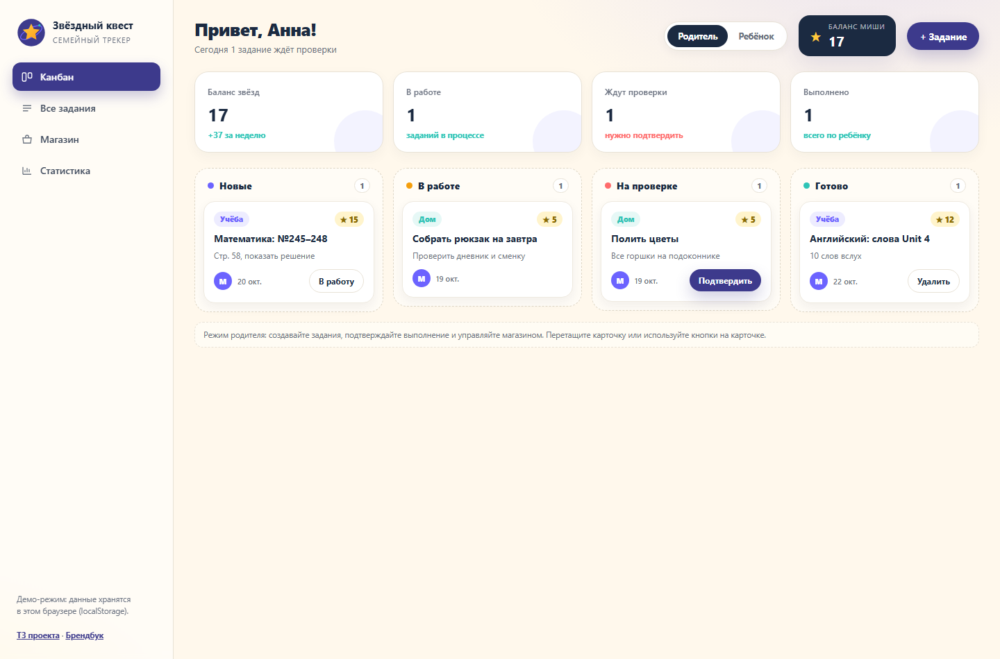
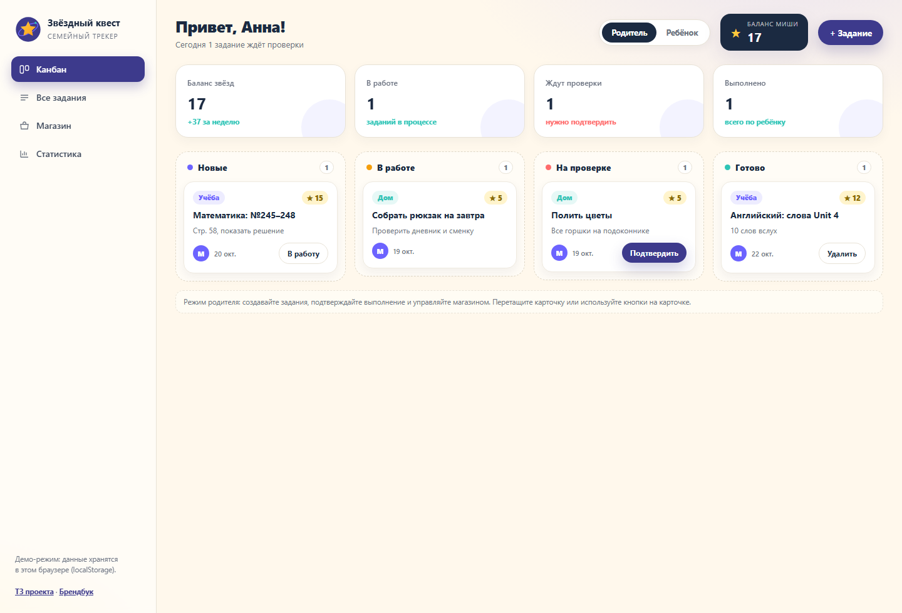
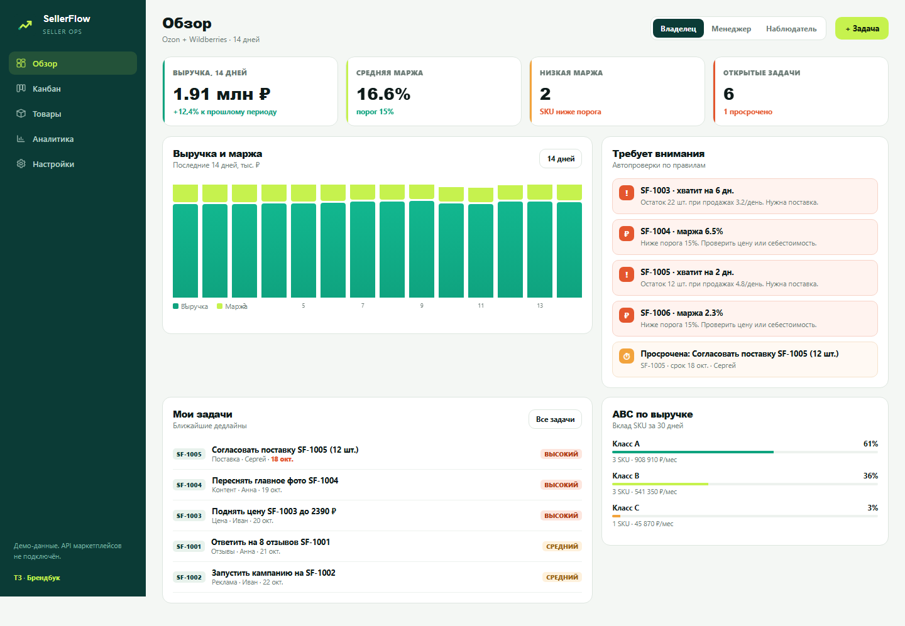
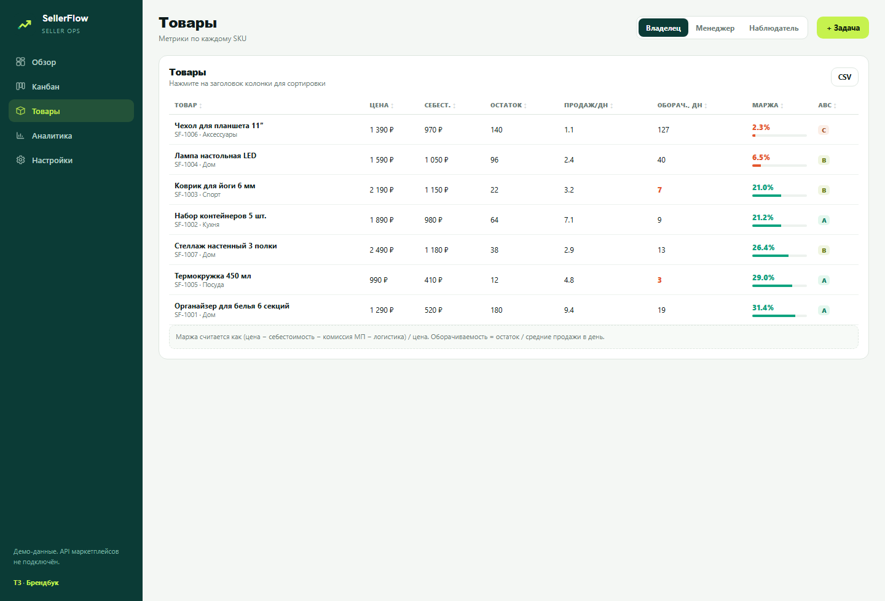
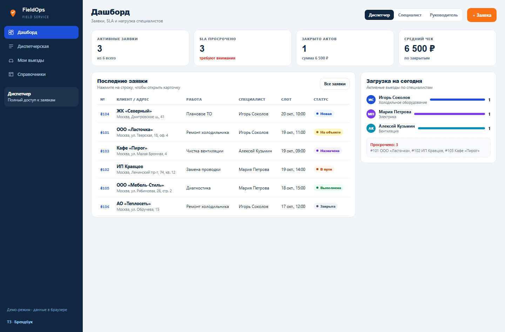
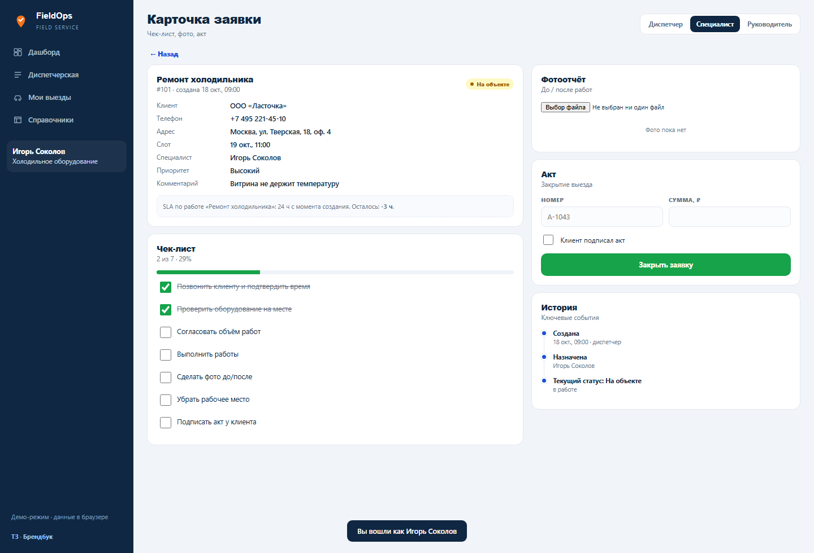
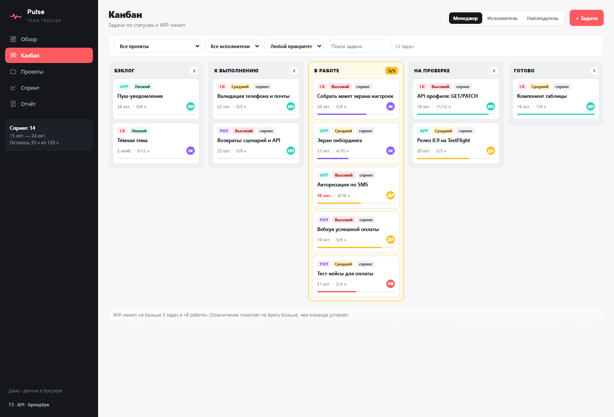
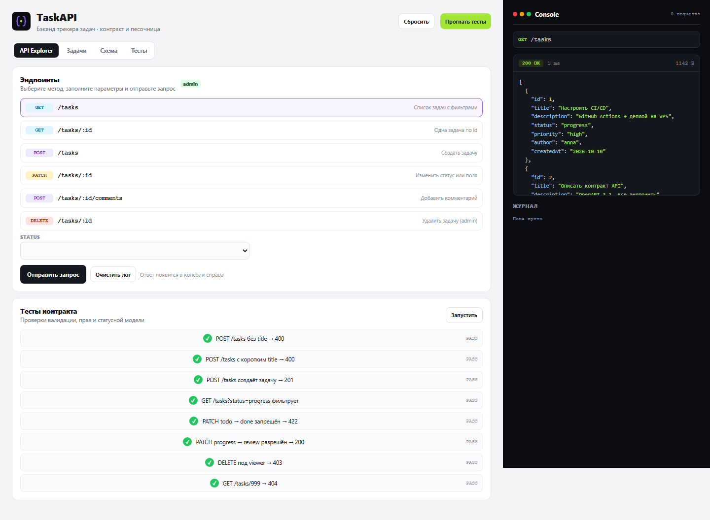
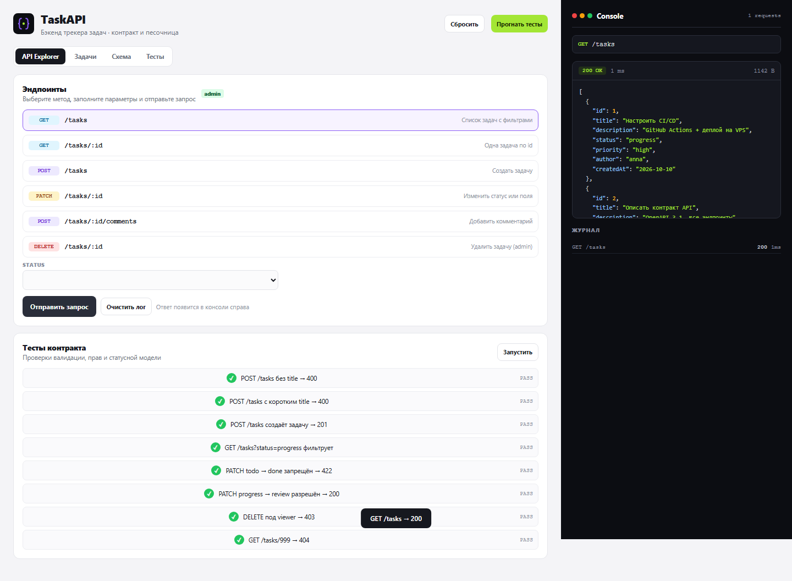

> [← Портфолио Марины Петрушиной](https://mary-rnd.github.io/portfolio/) — сайты, ИИ-боты, трекеры и автоматизация для малого бизнеса и MedTech.

<div align="center">

# 🔭 Трекеры на заказ — портфолио из 5 кейсов

**Каждый кейс — реальный заказ с биржи, разобранный по полному маршруту:**  
анализ заказа → вопросы клиенту → ТЗ → MVP → тестирование и доработки → публикация → упаковка услуги

[](https://mary-rnd.github.io/tracker-cases/)
[](#-кейсы)
[](#-технологии)
[](#-технологии)
[](https://github.com/Mary-RND/tracker-cases)

**▶ [Открыть витрину портфолио](https://mary-rnd.github.io/tracker-cases/)**

</div>

---

## 🔗 Живые версии (Live)

| № | Кейс | Тип | Live | ТЗ |
|---|------|-----|------|----|
| 01 | **Звёздный квест** | Семейный трекер · геймификация | [Открыть MVP](https://mary-rnd.github.io/tracker-cases/case1-starquest/) | [ТЗ](https://github.com/Mary-RND/tracker-cases/blob/main/case1-starquest/info/tz.md) |
| 02 | **SellerFlow** | Задачи и аналитика селлера · e-commerce | [Открыть MVP](https://mary-rnd.github.io/tracker-cases/case2-sellerflow/) | [ТЗ](https://github.com/Mary-RND/tracker-cases/blob/main/case2-sellerflow/info/tz.md) |
| 03 | **FieldOps** | Заявки и выездные специалисты · PWA | [Открыть MVP](https://mary-rnd.github.io/tracker-cases/case3-fieldops/) | [ТЗ](https://github.com/Mary-RND/tracker-cases/blob/main/case3-fieldops/info/tz.md) |
| 04 | **Pulse** | Командный трекер · проекты и спринты | [Открыть MVP](https://mary-rnd.github.io/tracker-cases/case4-pulse/) | [ТЗ](https://github.com/Mary-RND/tracker-cases/blob/main/case4-pulse/info/tz.md) · [API](https://github.com/Mary-RND/tracker-cases/blob/main/case4-pulse/info/api.md) |
| 05 | **TaskAPI** | Песочница REST API трекера | [Открыть MVP](https://mary-rnd.github.io/tracker-cases/case5-taskapi/) | [ТЗ](https://github.com/Mary-RND/tracker-cases/blob/main/case5-taskapi/info/tz.md) |

---

### 🔀 Отдельные репозитории (кейсы 3 и 4)

Два сильнейших кейса вынесены в самостоятельные проекты — со своим README, галереей, описанием услуги и живым демо:

| Проект | Живое демо | Репозиторий |
|--------|-----------|-------------|
| **FieldOps** — заявки, выезды, акты, PWA | https://mary-rnd.github.io/fieldops/ | [github.com/Mary-RND/fieldops](https://github.com/Mary-RND/fieldops) |
| **Pulse** — Kanban, спринты, отчёты | https://mary-rnd.github.io/pulse/ | [github.com/Mary-RND/pulse](https://github.com/Mary-RND/pulse) |

Этот же репозиторий остаётся витриной: одна ссылка на все пять кейсов с галереей, бюджетами и временем.

---

## 🖼 Галерея: первый запуск → финальная версия

<table>
  <thead>
    <tr><th>Кейс</th><th>Первый запуск</th><th>Финальная версия</th></tr>
  </thead>
  <tbody>
    <tr>
      <td><b>01</b><br>Звёздный квест</td>
      <td></td>
      <td></td>
    </tr>
    <tr>
      <td><b>02</b><br>SellerFlow</td>
      <td></td>
      <td></td>
    </tr>
    <tr>
      <td><b>03</b><br>FieldOps</td>
      <td></td>
      <td></td>
    </tr>
    <tr>
      <td><b>04</b><br>Pulse</td>
      <td></td>
      <td></td>
    </tr>
    <tr>
      <td><b>05</b><br>TaskAPI</td>
      <td></td>
      <td></td>
    </tr>
  </tbody>
</table>

---

## 📦 Кейсы

### 01 · Звёздный квест — семейный трекер с вознаграждением
- **Заказ:** [FL.ru №5258529](https://www.fl.ru/projects/5258529/sayt-treker-zadach-s-sistemoy-voznagrajdeniya-dlya-detey-i-roditeley.html) · бюджет **10 000 ₽**
- **Роли:** родитель подтверждает, ребёнок копит и обменивает
- **Механика:** баллы начисляются только после подтверждения родителем, магазин подарков, статистика
- **Выгрузка:** CSV и JSON

### 02 · SellerFlow — задачи селлера рядом с деньгами
- **Заказ:** [FL.ru №5005764](https://www.fl.ru/projects/5005764/razrabotat-veb-servis-dlya-upravleniya-zadachami.html) · по договорённости
- **Роли:** владелец, менеджер, наблюдатель (наблюдатель не видит кнопку создания)
- **Аналитика:** маржа, оборачиваемость, ABC-анализ, светофор проблем по каждому SKU

### 03 · FieldOps — заявки и выездные специалисты
- **Заказ:** [FL.ru №5517595](https://www.fl.ru/projects/5517595/razrabotat-sistemu-dlya-ucheta-zayavok-i-rabotyi-vyiezdnyih-spetsialistov.html) · по договорённости
- **Роли:** 4 уровня доступа (диспетчер, специалист, руководитель, админ)
- **Процесс:** SLA-таймеры, чек-лист работ, акт выполненных работ, фотоотчёт
- **PWA:** `manifest.webmanifest` + service worker — ставится на телефон

### 04 · Pulse — командный трекер с Kanban
- **Заказ:** [FL.ru №4523171](https://www.fl.ru/projects/4523171/razrabotka-trekera-zadach.html) · **300 000 ₽**
- **Роли:** менеджер, исполнитель, наблюдатель
- **Процессы:** проекты, спринты, WIP-лимит колонок (5/5), burndown, отчёты
- **Контракт API:** [info/api.md](https://github.com/Mary-RND/tracker-cases/blob/main/case4-pulse/info/api.md)

### 05 · TaskAPI — песочница REST API
- **Заказ:** [FL.ru №5096841](https://www.fl.ru/projects/5096841/napisat-bekend-dlya-trekera-zadach-na-java-zadanie-v-onlayn-shkole.html) · **2 000 ₽**
- **Контракт:** валидация полей, коды `200 / 201 / 204 / 400 / 403 / 404 / 405 / 422`
- **Права:** запрет обхода статусов (`todo → done` мгновенно запрещён), 8 тестов контракта
- **Важно:** песочница не изменяет данные основного приложения

> **Итого по пяти кейсам:** пять проектов · для портфолио отобраны **№3 FieldOps** и **№4 Pulse**

---

## 💰 Услуги и цены

| Кейс | MVP «под ключ» | Боевая версия (сервер, права, интеграции) |
|------|----------------|--------------------------------------------|
| 01 · Звёздный квест | **25 000 ₽** | 20 000–30 000 ₽ за похожий объём |
| 02 · SellerFlow | **45 000 ₽** | 90 000–120 000 ₽ с API и сервером |
| 03 · FieldOps | **60 000 ₽** | 150 000–220 000 ₽ с Битрикс24 |
| 04 · Pulse | **120 000 ₽** | 300 000–400 000 ₽ на PHP + React |
| 05 · TaskAPI | **8 000 ₽** | 25 000–35 000 ₽ на Java/Spring Boot |

**Формат передачи:** папка проекта, `index.html` + `info/` (ТЗ, брендбук, логотип), инструкция по деплою, чек-лист приёмки, видео 3–5 минут с прохождением сценариев.

**Допродажи:** серверная часть и авторизация, push и Telegram-уведомления, реальные интеграции (Битрикс24, Ozon/WB, Jira, Git), отчёты и выгрузки в Excel, импорт/экспорт данных, домен заказчика, поддержка и доработки.

**Порядок работы по каждому кейсу:** вопросы клиенту → ТЗ и критерии готовности → MVP → тестирование → 2–3 доработки → публикация → упаковка.

---

## 🛠 Технологии

| Область | Решение |
|---------|---------|
| Стек | Чистые `HTML5` + `CSS3` + `JavaScript (ES6)`, без фреймворков и сборки |
| Хранение данных | `localStorage` + демо-данные, состояние сохраняется после перезагрузки |
| Роли и доступ | Отдельные функции `canEdit()` / `canSee()` — права проверяются логикой, а не кнопкой |
| Адаптивность | От `360 px` до десктопа |
| PWA | `manifest.webmanifest` + `sw.js` (FieldOps) |
| Контракт API | `info/api.md` (Pulse), песочница ответов (TaskAPI) |
| Экспорт | CSV / JSON |
| Отладка | Консоль чистая, 0 ошибок; автотесты сценариев → `_tools/report.json` |

## 📁 Структура репозитория

```
tracker-cases/
├── index.html                  ← витрина портфолио
├── screenshots/                ← 10 скриншотов (первый запуск + финал)
├── case1-starquest/
│   ├── index.html              ← MVP
│   └── info/  tz.md · brandbook.md · logo.svg
├── case2-sellerflow/           ├── index.html + info/
├── case3-fieldops/             ├── index.html + info/ + manifest + sw.js
├── case4-pulse/                ├── index.html + info/ + api.md
└── case5-taskapi/              ├── index.html + info/
```

## ▶ Запуск локально

```bash
git clone https://github.com/Mary-RND/tracker-cases.git
cd tracker-cases
python -m http.server 8099
# → http://localhost:8099/
```

Или просто откройте `case*/index.html` в браузере — сборка не нужна.

## 🎨 Документы по каждому кейсу
- `info/tz.md` — вопросы клиенту, цель, роли, экраны, функции MVP, критерии готовности
- `info/brandbook.md` — палитра, типографика, правила интерфейса
- `info/logo.svg` — знак проекта
- `case4-pulse/info/api.md` — контракт API

## ⚠️ Дисклеймер
**Учебный проект** (кейс 4 FGIp07). На найденные заказы **не откликнулись** — ТЗ использованы только как материал для практики. Все данные демонстрационные и хранятся в `localStorage` браузера.
